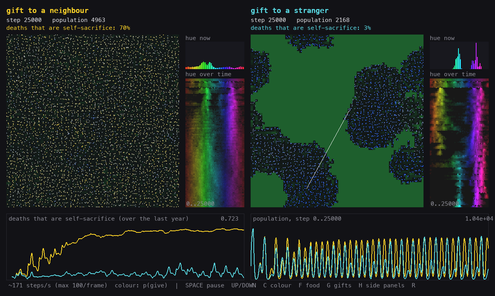

# kin-dots

An evolution simulation of dot agents that eat, reproduce and die, and that may (or may not) evolve altruism. Nothing in the rules tells them to help relatives, and they cannot recognise relatives. We check whether they start doing it anyway, and why.

**Main result: self-sacrifice.** A dot can give all its energy to a neighbour and die. Two genes decide how likely it is to do so. Over ~30,000 steps this rises from ~5% to **~70% of all deaths** when the gift goes to a neighbour (usually a relative). In the control, where the gift goes to a random dot anywhere on the map, it stays at **5–10%**. The two worlds differ in that one rule only.

**Start here: [Dots that give their lives](dots-that-give-their-lives.md)**, an explainer for newcomers: the rules, the experiment, the result and why it happens.

**Presentation:** [`presentation/index.html`](presentation/index.html) is an animated slide deck of the same story, made as a backdrop for a talk. It includes the model running live in the browser, a 3D torus and charts of the real runs. Open it in a browser (it needs internet for fonts and three.js). Keys: `→`/`←` to move, `N` for speaker notes, `F` for full screen. If your browser blocks local files, serve the folder:

```bash
python3 -m http.server 8000 --directory presentation   # then open http://localhost:8000
```

Its data comes from `analysis/deck_data.py`.



**Other threads:**

- Sharing with kin and restraint towards kin also evolve, and the controls show that relatedness is what drives them.
- Alarm calls against predators: the result was inconclusive.
- Two species with a front line, fighting only the other species and defending kin: parked.

## Installation

Native Python 3.12 via [uv](https://docs.astral.sh/uv/) (`brew install uv`):

```bash
uv venv --python 3.12 .venv
uv pip install --python .venv -e ".[dev]"
```

On Apple Silicon use a native (arm64) Python. An x86 Python under Rosetta crashes in Numba.

## The self-sacrifice demo

Two worlds side by side, same start and same random seed. Left: the gift goes to a neighbour. Right: the control, where the gift goes to a stranger.

```bash
./demo.sh            # seed 0, up to 64 steps per frame
./demo.sh 3 128      # seed 3, up to 128 steps per frame
```

What you see:

- Each world, with its population. Next to the count are last year's mean, min and max.
- The **share of deaths that are self-sacrifice**: all sacrifices of the last year divided by all deaths of the last year.
- Side panels with the **family colours**: a hue histogram now, and the same histogram over the whole run (time runs downward; a vertical band is one family).
- Two plots over the whole run: the sacrifice share, and the raw population.

Keys:

| key | action |
|---|---|
| `SPACE` | pause |
| `↑` / `↓` | faster / slower |
| `C` | colour mode: `p(give)`, `energy`, `tag` (inherited family colour), `family map (yearly)` |
| `F` | show / hide grass |
| `G` | show / hide the gifts of the last step (white lines) |
| `H` | show / hide the side panels |
| `R` | restart with the same seed |
| `Esc` / `Q` | quit |

A clear difference shows after ~10,000 steps, a few minutes at speed 64. The window fits the screen and the simulation runs in a fixed time budget per frame, so the window stays responsive. If a world dies out in the first winters (an unlucky seed), start with another seed.

### Changing the parameters

To see whether self-sacrifice still evolves in a different world, pass `--set` with any parameters. They apply to **both** worlds, so the two still differ by one rule only:

```bash
./demo.sh --set season_amplitude=0.7                  # milder winters
./demo.sh 3 --set move_speed=0.2 dispersal_sd=4       # seed 3, more mixing of families
```

To keep a set of changes, write them in a small YAML file, one `name: value` per line, and pass it with `--set-file`. It also applies to both worlds, and `--set` can still be added on top. [`configs/demo_overrides_example.yaml`](configs/demo_overrides_example.yaml) is a template to copy:

```bash
./demo.sh --set-file my_world.yaml
./demo.sh --set-file my_world.yaml --set move_speed=0.3
```

The window title shows the overrides, and a misspelt name or a value of the wrong type stops with an error.

The demo's own settings are in [`configs/demo_sacrifice.yaml`](configs/demo_sacrifice.yaml). The control, [`configs/demo_sacrifice_strangers.yaml`](configs/demo_sacrifice_strangers.yaml), is the same file plus `share_to_random: true`. You can also edit these two by hand. If you do, make every change in both files, or the worlds will differ in more than the one rule. `--set` and `--set-file` avoid that. Every parameter, with its default and a one-line meaning, is in [`kin_dots/core/params.py`](kin_dots/core/params.py). The ones most worth playing with:

| parameter | demo value | meaning | Evolife name |
|---|---|---|---|
| `season_amplitude` | 0.9 | how harsh winter is (0 = no seasons; grass grows with 1 + A·sin) | `WinterHarshness` |
| `season_period` | 600 | steps in a year | `SeasonLength` |
| `move_speed` | 0.1 | distance a dot moves per step | `Speed` |
| `dispersal_sd` | 2 | how far from its parent a child is born | `ChildSpread` |
| `interaction_radius` | 4 | how close a neighbour must be to be met | `MeetRadius` |
| `share_benefit` | 0.9 | share of the giver's energy that reaches the recipient | `GiftEfficiency` |
| `max_age` | 300 | death by old age | `MaxAge` |
| `birth_threshold` | 20 | energy needed to split in two | `BirthThreshold` |
| `food_growth`, `food_inflow` | 0.05, 0.1 | how fast grass regrows | `GrassGrowth`, `GrassInflow` |
| `founder_share_bias` | -9 | starting value of gene `a` | `InitialA` |
| `weight_mutation_sd` | 0.15 | mutation size of genes `a`, `b` and the other behaviour genes | `MutationSD` |
| `init_agents` | 2500 | starting population | `InitialPopulation` |
| `fertility_map` | `none` | `noise`: grass regrows faster in some places, like a relief map (smoothed random field, mean 1) | – |
| `fertility_contrast`, `fertility_scale` | 1.0, 40 | how strong and how large the fertile and barren patches are | – |
| `fertility_memory` | 1.0 | how the map changes each year: 1 = fixed, 0 = a new map, between = drifting | – |

### Evolife version

[`evolife/KinSacrifice/`](evolife/KinSacrifice) is the same demo as an app for [Evolife](https://evolife.telecom-paris.fr) (J.-L. Dessalles's framework). It is a standalone NumPy port and does not use the `kin_dots` package. To use it:

1. Install Evolife following its own instructions.
2. Copy the `KinSacrifice` folder into Evolife's `Apps/` folder.
3. Launch it the Evolife way: `./starter` on macOS and Linux, `Starter.bat` on Windows.

The starter opens Evolife's configuration editor, where every parameter of the model can be changed with a click, each with a short description. Examples: how harsh the winter is, how fast the dots move, how far from its parent a child is born, and how much of a gift reaches the recipient. This makes it easy to test whether self-sacrifice still evolves when the world is different. The control world (gift to a stranger) runs next to it with the same settings.

The Python that runs Evolife needs PyQt, numpy and Pillow. The app's `Help.txt` explains what is on screen and the keys.

## Figures and analyses

All figures are in `docs/`. Every script prints its own usage at the top of the file.

| figure | what it shows | made by |
|---|---|---|
| `demo_sacrifice.png` | share of deaths that are sacrifice, gene `b`, yearly mean population | `kin_dots.experiments.sweep` + `analysis/plot_sacrifice.py` |
| `demo_sacrifice_genes.png` | gene `a`, and p(sacrifice) as a function of own energy over time | `analysis/sacrifice_genes.py` |
| `demo_population.png` | raw population at every step | `analysis/population_runs.py` + `analysis/plot_population.py` |
| `demo_age_at_death.png`, `..._detail.png` | age at death by cause (sacrifice / hunger / old age), mean vs median, children before death, time of year | `analysis/age_at_death.py` |
| `demo_sacrifice_rate.png` | sacrifices per dot per step: through the year, over the run, by age | `analysis/age_at_death.py` |
| `demo_tags_yearly.gif` | yearly map of family colours over 150 years, with hue strips | `analysis/tag_movie.py` |
| `fertility.png` | self-sacrifice on a patchy landscape: fixed, drifting and yearly redrawn fertility maps vs a uniform one | `analysis/fertility_runs.py` + `analysis/plot_fertility.py` |

For example, to rebuild the main figure (~8 minutes on 6 cores):

```bash
.venv/bin/python -m kin_dots.experiments.sweep --steps 30000 --seeds 0 1 2 --windows 50 --procs 6 --out results/demo_curves \
  --cond-config sacrifice-local configs/demo_sacrifice.yaml --cond-config sacrifice-strangers configs/demo_sacrifice_strangers.yaml
.venv/bin/python analysis/plot_sacrifice.py results/demo_curves docs/demo_sacrifice.png
```

## The general simulation

Single-world live view (pygame):

```bash
.venv/bin/python -m kin_dots.viz.app --config configs/kin_altruism.yaml --speed 16
```

Keys:

- `SPACE` pause, `→` one step (when paused), `↑/↓` speed.
- `C` colour mode: `tag`, `species`, `p(share|kin)`, `p(attack|stranger)`, `p(alarm|kin)`, `p(defend|kin)`, `harvest`, `energy`.
- `F` food layer, `G` gifts, `R` restart, `N` new seed, `Esc` quit.

Headless, writing a time series to CSV:

```bash
.venv/bin/python -m kin_dots.experiments.run --steps 5000 --out results/run.csv
```

Both commands take `--config <file.yaml>` (default parameters otherwise) and `--seed N`.

Two worlds side by side with any pair of presets:

```bash
.venv/bin/python -m kin_dots.viz.compare --left configs/kin_altruism.yaml --right configs/kin_altruism_random_recipient.yaml \
  --left-label "help a neighbour" --right-label "help a random dot" --metric share_rate --speed 16
```

Many conditions and seeds in parallel, with a comparison table. `--table` picks the columns: `kin` relatedness metrics, `behaviour` genes and behaviour, `pred` predators and alarm calls, `species` species and defence.

```bash
.venv/bin/python -m kin_dots.experiments.sweep --steps 40000 --seeds 0 1 2 \
  --cond kin season_period=600 season_amplitude=0.9 move_speed=0.1 attacks_enabled=False \
  --cond control season_period=600 season_amplitude=0.9 move_speed=0.1 attacks_enabled=False share_to_random=True
```

Run sweeps from a file or the command line, not from stdin: on macOS, multiprocessing from stdin hangs.

### Presets in `configs/`

- `demo_sacrifice.yaml` / `demo_sacrifice_strangers.yaml`: the self-sacrifice demo and its control.
- `kin_altruism.yaml`: sharing with kin evolves.
- `kin_altruism_random_recipient.yaml`: control where the recipient is drawn from the whole map; altruism disappears.
- `kin_altruism_tagblind.yaml`: control where the sharing decision cannot see colour.
- `kin_restraint.yaml`: a variant with fights in which restraint towards kin evolves.
- `kin_alarm.yaml` / `kin_alarm_random_warn.yaml`: predators (red triangles) and alarm calls (white circles); the second is the control.
- `two_species.yaml` / `two_species_fights_within.yaml`: two species (dots and squares), fighting only the other species, defending a neighbour; the second is the control.
- `default.yaml`: the defaults.

## Tests

```bash
.venv/bin/pytest
```

The tests cover determinism (same seed, same run), exact energy and food bookkeeping, the kinship metrics, predators and the two-species variant.

## Code layout

- `kin_dots/core/params.py`: all parameters (`Params`).
- `kin_dots/core/genome.py`: genome layout (which columns are which genes).
- `kin_dots/core/world.py`: state as NumPy arrays and the simulation step.
- `kin_dots/core/kernels.py`: Numba kernels (neighbours, sharing and sacrifice, fights, social movement).
- `kin_dots/core/genealogy.py`: family tree and interaction log.
- `kin_dots/core/kinship.py`: kinship metrics (relatedness, Hamilton's rule, Price equation, clans and cheaters).
- `kin_dots/core/predation.py`: predators, detection, alarm calls (Numba).
- `kin_dots/viz/app.py`: single-world pygame window.
- `kin_dots/viz/compare.py`: two worlds side by side (the demo viewer).
- `kin_dots/experiments/run.py`: headless runner.
- `kin_dots/experiments/sweep.py`: many conditions and seeds in parallel, comparison table.
- `analysis/`: scripts behind the figures in `docs/`.
- `evolife/KinSacrifice/`: the demo as an Evolife app (standalone).
- `configs/`: parameter presets.
- `tests/`: determinism, energy and food balance, state consistency.
