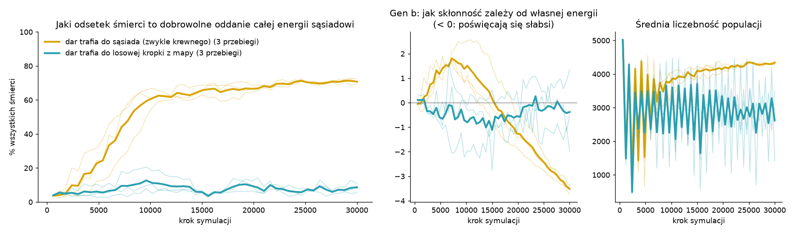
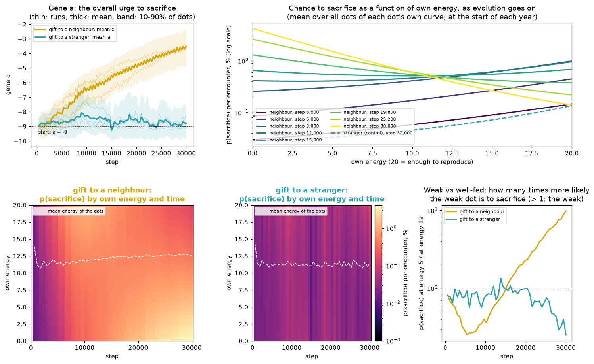
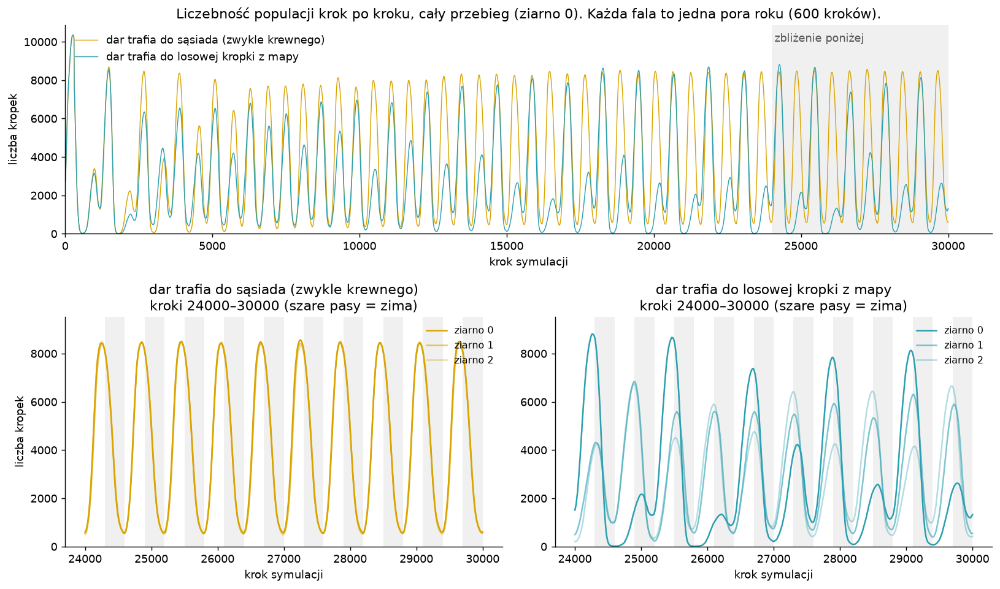
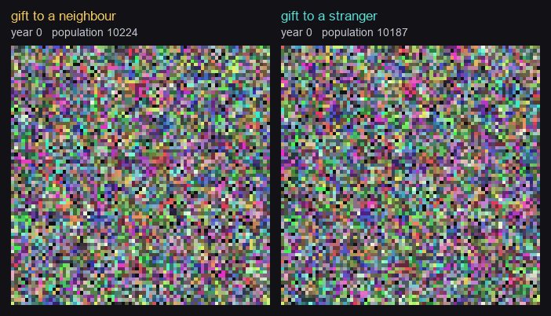
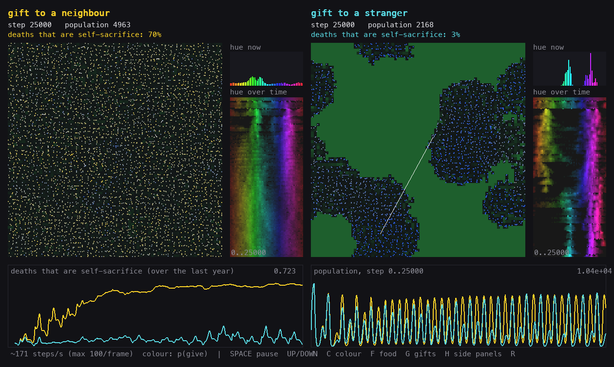

# Demo: kropki, które oddają życie za rodzinę



## Zasady (do opowiedzenia w minutę)

1. Na mapie rośnie trawa. Zimą odrasta dużo wolniej (pory roku).
2. Kropki powoli chodzą w stronę trawy i ją jedzą. Każdy krok kosztuje trochę energii.
3. Kropka z zerową energią umiera z głodu. Po 300 krokach umiera ze starości.
4. Gdy kropka uzbiera 20 energii, dzieli się na dwie. Dziecko pojawia się tuż obok i dziedziczy geny z drobną mutacją.
5. **Jedna dodatkowa możliwość:** w każdym kroku kropka może **oddać całą swoją energię losowemu sąsiadowi i umrzeć**.
6. O tym, jak często to robi, decydują **dwa geny**: `p = sigmoid(a + b · moja energia)`. Na starcie `a = −9`, więc tak umiera tylko ~5% kropek.
7. Ewoluuje jeszcze jeden gen: jak mocno kropka kieruje się w stronę trawy. W obu światach rośnie podobnie (z ~1.2 do ~4–8), więc nie wyjaśnia różnicy między nimi.

**Czego w modelu nie ma:**
- rozpoznawania krewnych (kropki nie widzą, kto jest kim),
- nagrody za pomoc ani pojęcia grupy czy gatunku „do ratowania”,
- walk i komunikacji,
- jakiejkolwiek reguły, która mówi „pomagaj rodzinie”.

## Pytanie do widowni

> Kropka, która się poświęca, umiera i nie ma już dzieci. Czy po 30 tysiącach kroków poświęceń będzie więcej, czy mniej?

Prawie każdy odpowie, że gen „zabij się” szybko wyginie.

## Wynik

| | na starcie | po 30 000 kroków |
|---|---|---|
| **dar trafia do sąsiada** | ~5% śmierci to poświęcenia | **~70%** (3 z 3 przebiegów) |
| dar trafia do losowej kropki z mapy (kontrola) | ~5% | 5–10% (3 z 3) |

**Co dokładnie wyewoluowało:**
- Ewoluuje reguła **„poświęcam się, kiedy jestem słaby”** (gen `b` spada do ≈ −3.5). Przez pierwsze ~15 tys. kroków reguła idzie w przeciwną stronę: poświęcają się raczej najedzeni (środkowy wykres).
- **Gen `a`** (ogólna skłonność) rośnie przez cały przebieg z −9 do ≈ −3.5; w kontroli stoi w miejscu (~ −8.7). Od ok. kroku 12 tys. kropka ze średnią energią poświęca się przy spotkaniu z mniej więcej stałą szansą ~0.5%. Dalej zmienia się już głównie to, *kto* się poświęca: po 30 tys. kroków kropka z energią 5 robi to z szansą ~1.5%, a prawie gotowa do rozmnożenia (19) ~0.16%, czyli 10× rzadziej. Po 30 tys. kroków ten proces jeszcze się nie zatrzymał (`analysis/sacrifice_genes.py`, 3 przebiegi).
  
- Kropki, które się poświęcają, **nie są na skraju śmierci**. Mają ~9.6 energii przy średniej ~12.5, a śmierć głodowa przychodzi dopiero przy 0. Tracą więc realną szansę na przeżycie i potomstwo.
- **Efekt uboczny, którego nikt nie zaprojektował:** w świecie kontrolnym populacja wpada w cykl dwuletni, czyli rok obfitości, potem rok krachu (prawy wykres, średnia z każdej pory roku skacze między ~1500 a ~3500). W świecie z poświęceniem ten cykl wygasa, a populacja stabilizuje się na ~4300.
  

  Bez uśredniania widać to jeszcze wyraźniej. W świecie z darem dla sąsiada wszystkie trzy przebiegi mają **prawie identyczny, regularny rytm**: ~8500 kropek latem i ~600 zimą, rok w rok. W świecie kontrolnym lata są na przemian duże i małe, a zimą populacja często spada prawie do zera.

- **Rody: osiadłe vs wędrowne.** Mapa poniżej pokazuje średni dziedziczny kolor kropek w każdym kawałku świata, czyli rody. Jedna klatka to jeden rok, zawsze w szczycie lata, przez 150 lat (90 tys. kroków).

  

  - W świecie z darem dla sąsiada wiele rodów współistnieje w mozaice, która zmienia się powoli. Rody przeżywają zimę na miejscu i co roku odradzają się w tym samym rejonie.
  - W świecie kontrolnym zimowe krachy wybijają większość rodów. Zostaje kilka wielkich, które co roku na nowo zalewają opustoszałe tereny.
  - Liczbowo: kropka żyje średnio (mediana) **11.6** jednostki od miejsca, w którym rok wcześniej żył jej przodek. W świecie kontrolnym to **21.1** (lata 25–150).
  - Pod każdą mapą są dwa paski. **„dots by colour hue now”** to histogram odcieni kolorów w danej chwili (pełny słupek = 15% kropek). **„hue over time”** to historia odcieni od startu: oś x to czas, oś y odcień, a jasność to liczba kropek. Trwałe rody widać jako poziome pasy. Po lewej przez 150 lat utrzymuje się szeroka „tęcza” wielu rodów. Po prawej pojedyncze rody zalewają resztę i znikają, a około 60. roku jeden fioletowy ród ma ~40% populacji.
  - Szybsza wersja, z klatką co 150 kroków, w której widać też pory roku: `docs/demo_tags.gif`. Ma ~40 MB, więc nie jest w gicie. Odtworzysz ją komendą poniżej albo, bez ponownego liczenia, z zapisanych danych: `analysis/tag_movie.py docs/demo_tags.gif docs/demo_tags_yearly.gif cache`.

- **Samobójstwo bez daru** (kropka umiera, a jej energia przepada) daje mieszane wyniki: 61%, 44% i 6% śmierci w trzech przebiegach. Liczy się więc *dar dla krewnych*, a nie samo zwolnienie miejsca.

## Dlaczego tak się dzieje

Dziecko rodzi się obok rodzica, a kropki prawie się nie ruszają, więc **sąsiad to prawie zawsze bliski krewny**. W modelu bezpłciowym oznacza to niemal kopię tych samych genów (zmierzone pokrewieństwo genetyczne ~0.75).

Słaba kropka zimą ma marne szanse dożyć wiosny i się rozmnożyć. Gen „gdy jesteś słaby, oddaj wszystko sąsiadowi” przenosi więc jej energię do silniejszych krewnych, którzy noszą *ten sam gen* i mają większą szansę go przekazać.

To jest **reguła Hamiltona**: pomoc opłaca się, gdy zysk biorcy pomnożony przez pokrewieństwo przewyższa koszt dawcy. W kontroli dar trafia do obcych (pokrewieństwo ≈ 0), więc gen nie zyskuje nic i nie rośnie.

Nikt tu niczego „dla dobra gatunku” nie robi. Selekcja działa na geny, a altruizm jest jej skutkiem ubocznym.

## Jak to puścić

Dwa światy obok siebie. Różnią się tylko tym, kto dostaje dar:

```bash
./demo.sh            # albo: ./demo.sh <ziarno> <kroki na klatkę>
```

Co robi skrypt:

```bash
.venv/bin/python -m kin_dots.viz.compare --left configs/demo_sacrifice.yaml --right configs/demo_sacrifice_strangers.yaml \
  --left-label "dar dla sąsiada" --right-label "dar dla obcego" --metric sacrifice_frac --speed 64
```



**Co jest na ekranie:**
- **Kolor kropki** pokazuje, jak skłonna jest *teraz* do poświęcenia: niebieska prawie nigdy, żółta często (skala logarytmiczna). Lewy świat z czasem żółknie, prawy zostaje niebieski.
- **Białe kreski** to dary z ostatniego kroku. W lewym świecie są krótkie, od dawcy do sąsiada. W prawym biegną przez całą mapę.
- **Wykres na dole** pokazuje odsetek śmierci, które są poświęceniem, liczony z ostatniego roku (wszystkie poświęcenia z roku podzielone przez wszystkie śmierci z roku), za cały przebieg.
- **Panele boczne** (klawisz `H` je chowa): przy każdym świecie histogram odcieni kolorów rodów w danej chwili i historia odcieni w czasie (czas w dół, trwałe rody to pionowe pasy).
- **Tryb kolorowania „family map (yearly)”** (klawisz `C`): zamiast kropek mapa rodów, odświeżana raz na rok w szczycie lata.
- **Klawisze:**
  - `SPACJA` pauza, `↑/↓` szybkość, `R` restart,
  - `C` zmienia kolorowanie (np. energia),
  - `F` pokazuje albo ukrywa trawę, `G` pokazuje albo ukrywa dary.

Wyraźna różnica pojawia się po ~10 tys. kroków. Przy prędkości 64 to kilka minut.

**Wykres z artykułu można odtworzyć** (~8 minut na 6 rdzeniach):

```bash
.venv/bin/python -m kin_dots.experiments.sweep --steps 30000 --seeds 0 1 2 --windows 50 --procs 6 --out results/demo_curves \
  --cond-config sacrifice-local configs/demo_sacrifice.yaml --cond-config sacrifice-strangers configs/demo_sacrifice_strangers.yaml
```

```bash
.venv/bin/python analysis/plot_sacrifice.py results/demo_curves docs/demo_sacrifice.png
```

Wykres liczebności (~3 minuty):

```bash
.venv/bin/python analysis/population_runs.py results/population.npz
```

```bash
.venv/bin/python analysis/plot_population.py results/population.npz docs/demo_population.png
```

GIF-y z mapą rodów (90 tys. kroków, ~10 minut):

```bash
.venv/bin/python analysis/tag_movie.py docs/demo_tags.gif docs/demo_tags_yearly.gif 90000
```

## Uczciwe zastrzeżenia

- **Rozmnażanie jest bezpłciowe,** więc krewni to prawie klony. Przy rozmnażaniu płciowym (pokrewieństwo ½ i mniej) efekt byłby słabszy.
- **Parametry świata dobrałem tak, żeby efekt był wyraźny.** Właśnie dlatego kontrola jest kluczowa: różni się *jedną* regułą (kto dostaje dar), a wynik idzie w przeciwną stronę.
- **Efekt słabnie, ale nie znika, gdy świat jest łagodniejszy albo rodziny trzymają się mniej razem.** Odsetek śmierci przez poświęcenie po ~19 tys. kroków (2 przebiegi na wariant, `results/sac_robust`):

  | wariant | poświęcenia |
  |---|---|
  | preset (zima 0.9, ruch 0.1) | ~70% |
  | łagodniejsza zima 0.8 / 0.7 | ~60% / ~48% |
  | szybszy ruch 0.2 | ~56% |
  | dziecko dalej od rodzica (sd 4 zamiast 2) | ~56% |
  | krótsze pory roku (400 zamiast 600 kroków) | ~38% |
  | **kontrola: dar dla obcego** (zima 0.8) | **~8%** |

  Tak przewiduje teoria: im srożej i im bliżej rodziny, tym więcej poświęcenia.
- **Pierwsze zimy to wąskie gardło.** Zanim poświęcenie się rozpowszechni, populacja przechodzi przez cykl dwuletni. Po pierwszej i trzeciej zimie zostaje czasem tylko 10–130 kropek. Sprawdziłem ziarna 0–7 i wszystkie przeżywają, ale dla innego ziarna demo może wymrzeć na starcie. Wtedy trzeba uruchomić je z innym `--seed` (`R` restartuje to samo ziarno, więc nie pomoże).
- **Prawdopodobieństwo jest liczone na krok.** Nawet 0.6% na krok przez ~300 kroków życia daje dużą szansę na poświęcenie w ciągu życia.

## Inne wyniki z tego projektu

Szczegóły są w [PLAN.md](PLAN.md), sekcja 8.
- **Oddawanie po jednej jednostce energii** (`configs/kin_altruism.yaml`): wyewoluowało „biedni oddają bogatszym krewnym”. Pomoc trafia do bliższych krewnych niż przeciętni sąsiedzi.
- **Powściągliwość w walce** (`configs/kin_restraint.yaml`): kropki rzadziej atakują krewnych.
- **Nie zadziałały:**
  - krzyk ostrzegawczy przed drapieżnikami (wynik niejednoznaczny),
  - powściągliwość w jedzeniu (to był egoizm, nie altruizm),
  - nawożenie trawy jako dobro wspólne (gen zanikał).
